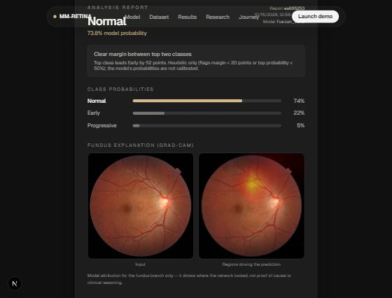
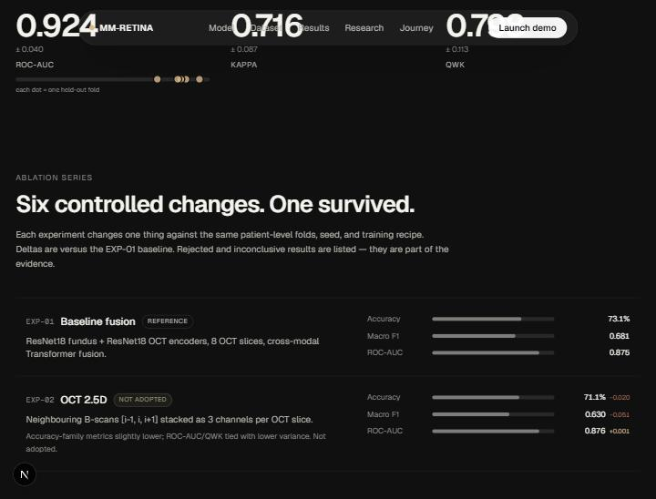
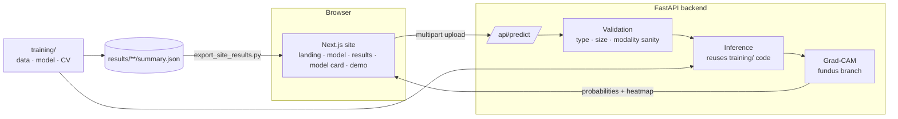

# MM-RETINA

**Multimodal glaucoma grading from OCT + fundus imaging — with the evidence, the failures, and a live demo.**

MM-RETINA asks one question: *do two views of the same eye beat one?* It grades glaucoma severity
(normal / early / progressive) from a colour fundus photograph and an OCT B-scan volume, measures the
answer with patient-level cross-validation, and ships the whole thing as a research site plus a real
inference API with Grad-CAM explanations.

> **Research prototype. Not a medical device. Not for clinical use.** See the
> [model card](website/src/app/model-card/page.tsx) (served at `/model-card`) for intended use and limitations.

| | |
|---|---|
|  |  |
| Live demo: probabilities, margin flag, Grad-CAM, printable report | Every ablation, including the ones that failed |

## Headline result

Frozen best configuration — `fusion_effnetb0_v1` (EfficientNet-B0 fundus + ResNet18 OCT × 8 slices + cross-modal
fusion). Patient-level, grade-stratified 5-fold cross-validation over 100 labelled GAMMA patients,
mean ± std across folds:

| Accuracy | Balanced acc. | Macro F1 | ROC-AUC | Kappa | QWK |
|---:|---:|---:|---:|---:|---:|
| 82.0% ± 5.5 | 79.0% ± 5.7 | 0.781 ± 0.061 | 0.924 ± 0.039 | 0.716 ± 0.087 | 0.798 ± 0.113 |

Six controlled changes were tested against the same folds; one was adopted (EfficientNet-B0). 2.5D OCT, 12/16
slices and token-level fusion were rejected or inconclusive, and are reported as such — see
[`EXPERIMENTS.md`](EXPERIMENTS.md) and the site's `/results` page.

With 100 patients the fold-to-fold spread is large. Treat differences smaller than about one standard deviation
as noise.

## Four modalities, honestly

Fundus and OCT are paired per patient in GAMMA, so they are **fused** (the headline model). Visual-field (HVF) and
RNFL/GCC data have no valid patient or eye link to GAMMA or to each other (see
`dataset/rnfl_gcc_provenance_audit.md`), so each is a **standalone linear model** on its own
Mild / Moderate / Severe scale (`training/train_tabular_encoders.py`). The demo runs them side by side with a
reliability badge taken from their own cross-validation, and there is deliberately no combined score:

| Model | Scale | CV ROC-AUC | Reliability shown in the UI |
|---|---|---:|---|
| Fundus + OCT (fused) | normal / early / progressive | 0.924 | strong |
| RNFL / GCC thickness | mild / moderate / severe | 0.756 | moderate (folds not patient-grouped: optimistic) |
| Visual field (HVF, no-proxy) | mild / moderate / severe | 0.571 | no better than chance |

## What's in the box



| Path | What it is |
|---|---|
| `training/` | Data loading, model (`model.py`), 5-fold CV runner, evaluation, standalone HVF / RNFL-GCC models (`tabular_models/`) |
| `results/` | Real per-fold metrics, predictions and confusion matrices for every experiment |
| `backend/` | FastAPI inference service + API tests — loads the real checkpoints, never fabricates a result |
| `website/` | Next.js 16 site: results, model card, interactive OCT viewer, live demo |
| `scripts/export_site_results.py` | Generates the website's numbers from `results/**/summary.json` |
| `EXPERIMENTS.md`, `PROGRESS.md` | Append-only log of every run, including failures |
| `dataset/` | Dataset docs, loaders, split files, HVF and RNFL/GCC feature pipelines |

## Run it

```bash
# 1. Backend (needs the demo checkpoints in training/checkpoints/)
cd backend
pip install -r requirements.txt
uvicorn app:app --port 8000

# 2. Website (second terminal)
cd website
npm install
cp .env.local.example .env.local      # points the site at the backend
npm run dev                           # http://localhost:3000
```

Open `/demo` and press **Run sample case** — real GAMMA sample, true 8-slice OCT volume, Grad-CAM on.

Or with Docker (checkpoints mounted read-only): `docker compose up --build`.

### Test

```bash
cd backend && pip install -r requirements-dev.txt && python -m pytest -q   # API contract + real inference if checkpoints exist
cd website && npm run lint && npm run build
python scripts/export_site_results.py --check                              # website numbers match results/
```

CI (`.github/workflows/ci.yml`) runs the same three checks on every push.

## Honest by construction

- **Numbers can't drift.** The website's metrics are generated from `results/**/summary.json`; CI fails if they
  go stale. (This exists because the results page once lagged behind the best model.)
- **The demo says what it is.** It serves earlier single-split checkpoints (`fusion_run1`, ResNet18 + ResNet18),
  *not* the EfficientNet-B0 model measured above — the CV fold checkpoints were intentionally not retained.
  A demo prediction is not evidence for the CV metrics, or the reverse.
- **No silent fallbacks.** A missing checkpoint returns HTTP 503, not a made-up prediction. A single uploaded OCT
  image repeated across the slice positions is reported as `repeated_single_slice`, never as a real volume.
- **The "review" flag is a heuristic.** Probabilities are not calibrated; the flag marks a small margin between the
  top two classes, nothing more.

## Data and licence

GAMMA (CC BY-NC-ND) — see [`dataset/README.md`](dataset/README.md) for the citation and terms. The dataset is
not redistributed here beyond a single sample (GAMMA 0001: its fundus photo and B-scans) used for the demo and OCT viewer. Because of the non-commercial
licence, models trained on it are for research use only.

> Wu J., Fang H., Li F., Fu H., Lin F., et al. "GAMMA Challenge: Glaucoma grAding from Multi-Modality imAges."
> *Medical Image Analysis*, 2023.
